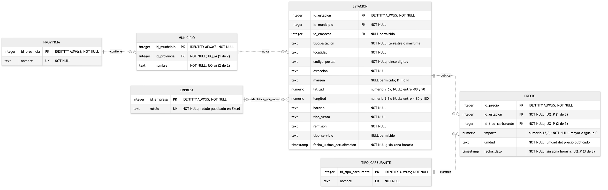

# Actividad 1 · Base de datos de carburantes

Esta práctica almacena en PostgreSQL las estaciones terrestres y marítimas de dos Excel del Ministerio incluidos en el material docente. Contiene el modelo, el DDL, un importador en Python y las cinco consultas del enunciado.

PostgreSQL se ejecuta en Docker. Python se ejecuta en el ordenador mediante **uv**, que prepara Python 3.12 y las dependencias de `requirements.txt`.

## Contenido de la entrega

| Apartado | Archivos |
|---|---|
| Modelo relacional | [Diagrama](modelo-er.png), [fuente editable](modelo-er.mmd) y [decisiones del modelo](modelo-er-notas.md) |
| Creación del esquema | [DDL](sql/01_esquema.sql) |
| Ingesta completa | [Programa Python](cargar_excel.py), [dependencias](requirements.txt) y [datos de entrada](datos/) |
| Entorno y demostración | [Docker Compose](compose.yaml), [configuración de ejemplo](.env.example) y [script de ejecución](demo_videomemoria.sh) |
| Consultas SQL | [1. Terrestres](sql/03_consulta_01.sql), [2. Marítimas](sql/04_consulta_02.sql), [3. Madrid](sql/05_consulta_03.sql), [4. Albacete](sql/06_consulta_04.sql) y [5. Precio marítimo](sql/07_consulta_05.sql) |
| Resultados | [Resultados de las cinco consultas](resultados/README.md) |
| Videomemoria | Pendiente de grabación y de añadir su enlace |

## Videomemoria

**Pendiente.** La grabación está prevista para el 24 de noviembre de 2026. El enlace se añadirá aquí después de comprobar el audio, la legibilidad y los permisos de acceso. Hasta entonces, la entrega está incompleta.

## Modelo relacional



Las relaciones y las decisiones de diseño se explican en [las notas del modelo](modelo-er-notas.md).

## Preparación

Se necesitan Docker con Docker Compose v2 y uv, acceso a Internet en la primera ejecución y el puerto local 55432 disponible. En macOS hay que iniciar Docker Desktop. En Windows se utiliza una terminal Bash de WSL con Docker integrado en esa distribución y uv instalado allí.

Para descargar y preparar el proyecto:

```bash
git clone https://github.com/manueld79/tfu-bbdd-actividad1.git
cd tfu-bbdd-actividad1
cp .env.example .env
```

También se puede descargar desde **Code → Download ZIP** en GitHub, descomprimirlo y abrir una terminal en la carpeta extraída antes de copiar `.env.example`.

Edita `.env` y sustituye la contraseña de ejemplo por una contraseña local. `.env` no se incluye en la entrega ni en Git. PostgreSQL utiliza esa contraseña cuando inicializa el volumen; cambiarla en el archivo no cambia la contraseña de un volumen ya creado.

## Ejecutar la demostración

```bash
# Modo recomendado para grabar: pulsa Enter entre bloques.
bash demo_videomemoria.sh --manual

# Ejecución automática con ocho segundos de pausa entre bloques.
bash demo_videomemoria.sh

# Comprobación automática sin pausas.
bash demo_videomemoria.sh --pausa 0
```

El script realiza este recorrido:

1. Comprueba archivos, herramientas y las cinco consultas, y arranca PostgreSQL.
2. Crea una base nueva `carburantes_demo_<fecha>_<hora>_<proceso>`, aplica el DDL y comprueba que contiene `0 | 0` estaciones y precios.
3. Lee los dos Excel y carga los datos en una transacción. El importador comprueba que el número de estaciones y precios por tipo coincide con lo leído antes de confirmar.
4. Muestra los recuentos finales y el reparto terrestre/marítimo.
5. Ejecuta las cinco consultas, mostrando su SQL y sus resultados. Si hay empate, conserva todas las filas empatadas.

La salida se guarda en `logs/demo_<sesion>.log` y los resultados en `logs/resultados_<sesion>/*.csv`. Las bases anteriores se conservan; cada ejecución utiliza una nueva y no borra datos. El script se detiene si falla un comando.

Puede indicarse otro directorio con `--origen /ruta/a/datos`. Debe contener los dos nombres de archivo esperados y la estructura de columnas compatible. Los recuentos y resultados documentados aquí corresponden únicamente a la pareja histórica incluida.

## Datos y resultados

Se utiliza una instantánea reproducible: ambos archivos fueron publicados el **11 de noviembre de 2025 a las 16:00**. No representan precios actuales. Los archivos y el modelo de referencia proceden del [repositorio docente del curso 2025–2026](https://github.com/jarturomora/bases-datos-avanzadas-gii/tree/curso-2025-2026/actividades/a1-laboratorio). Las decisiones de adaptación se explican en `modelo-er-notas.md`.

| Origen | Estaciones | Precios |
|---|---:|---:|
| Terrestre | 12.073 | 43.678 |
| Marítimo | 136 | 254 |
| Total | 12.209 | 43.932 |

| Consulta | Resultado con estos archivos |
|---|---|
| 1. Empresa con más estaciones terrestres | REPSOL: 2.733 |
| 2. Empresa con más estaciones marítimas | REPSOL: 69 |
| 3. Gasolina 95 E5 más barata en Madrid | PLENERGY, Meco: 1,309 EUR/l |
| 4. Gasóleo A más barato a un máximo de 10 km del centro de Albacete | A&A: 1,288 EUR/l; distancia aproximada 2,711 km |
| 5. Provincia de la estación marítima con Gasolina 95 E5 más cara | Alicante y Granada, empatadas a 1,852 EUR/l |

La tabla `empresa` representa el **rótulo**. Las cuatro estaciones marítimas sin rótulo se cargan, pero no se les atribuye una empresa en los recuentos por marca. Las consultas de precios utilizan `LEFT JOIN` para conservar estaciones aunque no tengan rótulo.

Para la consulta 4 se adopta el punto **38.9943, -1.8585** como referencia aproximada del centro urbano de Albacete. La fórmula de Haversine calcula la distancia sobre una esfera de radio medio 6371 km. Se filtra un radio de 10 km sin redondear y luego se redondea la distancia para mostrarla. No es una distancia de conducción; si el criterio fuera un recorrido por carretera, haría falta información de rutas. No se restringe la búsqueda al municipio, porque puede haber estaciones próximas en otro municipio.

## Criterios seguidos

El trabajo incluye el modelo relacional, el DDL, la ingesta completa y las cinco consultas con sus resultados. La videomemoria mostrará el diagrama, el esquema y la ejecución desde una base vacía hasta la carga completa, además de las consultas en directo.

Aunque el enunciado escrito indica Java, en la clase del 10 de noviembre el profesor permite elegir lenguaje y acepta Python y psql (21:58–23:31). También permite los Excel del curso anterior (02:10–03:13), automatizar la demostración (03:17–03:58) y entregar un repositorio acompañado del enlace al vídeo (31:26–32:17). En la sesión del 17 de noviembre confirma que se puede leer directamente desde Excel o CSV (51:39–52:06) y entregar las consultas en archivos SQL (52:32–52:56).

## Verificación

La ejecución completa se comprobó el 13 de noviembre de 2026 en macOS con PostgreSQL 16 en Docker. El 23 de noviembre se revisaron los archivos y se recalcularon los resultados directamente desde los Excel; coinciden con los CSV incluidos. El detalle está en [resultados](resultados/README.md). La ejecución nativa en WSL no se ha comprobado.

Cada nueva ejecución genera su registro y los resultados CSV en `logs/`, una carpeta local excluida de Git. La contraseña local de `.env` también queda excluida.
